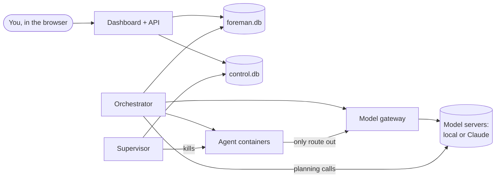
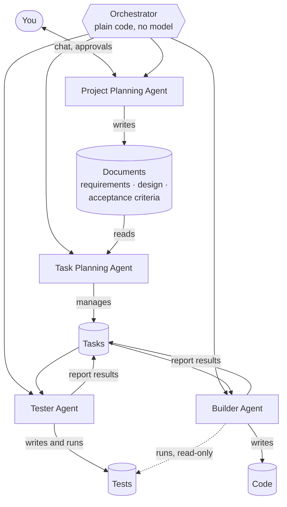

# How Foreman works

This document explains how Foreman is put together and why, in plain language.
For setup and usage see the [README](README.md); for the formal requirements
see [`specs/000-orchestrator/`](specs/000-orchestrator/).

## The big picture

Think of a foreman on a building site. They don't lay bricks. They agree the
plans with the client, break the job into pieces small enough for one worker,
hand each piece out, check the work, adjust the plan as things come up, and
stop everything if something goes wrong.

Foreman does that for software, with four kinds of worker, each allowed to
do one job and nothing else:

- the **Project Planning Agent** agrees the requirements, design and
  acceptance criteria with you, in plain language;
- the **Task Planning Agent** breaks that work into small tasks and keeps the
  task list up to date;
- the **Tester Agent** writes the tests for each task, before any code exists;
- the **Builder Agent** writes the code that makes those tests pass.

Foreman itself, the **Orchestrator**, is ordinary code, not a model. It hands
out the work, checks every result, merges it, and refuses anything an agent
does outside its role. You watch it all in a web dashboard and can stop
anything at any moment.

The models can be local (your Mac Studio, your mini PC) or Claude, and each
agent can use a different one.

## The four agents

| Agent | May | May not |
|---|---|---|
| Project Planning Agent | write the requirements, design and acceptance criteria (markdown); talk with you; research topics on the web | write code, tests or commands; create or change tasks |
| Task Planning Agent | read the documents; create, split, change and remove tasks, in plain language; propose a change to the documents (you decide) | write documents, code or tests; name files or commands |
| Tester Agent | write and change files under the project's test paths (`tests/` by default); run commands and tests | change any file outside the test paths |
| Builder Agent | write and change code, docs (`README.md`, `ARCHITECTURE.md`) and the toolchain Dockerfile; run commands, including the tests | change any test |

The point of the split: **the agent that writes the code can't shape the
tests that judge it**, and the planners think about *what* to build, never
*how* to code it.

These rules are enforced, not just asked for:

- **The planners have no tools.** They only send text back. Foreman reads
  out of it the actions that role is allowed (document files for the
  Project Planner, task changes for the Task Planner) and ignores the rest.
  A task that names files or commands is refused.
- **The Tester and Builder get different views of the repository.** In the
  Tester's container the code is mounted read-only and only the test folders
  are writable; in the Builder's it is the other way round.
- **Every change is checked afterwards.** After each step Foreman looks at
  what changed. A Tester that touched code, or a Builder that touched a test
  (including test files kept next to the code, like `foo_test.go`), fails
  the step, and its changes are thrown away.
- Anything refused is recorded as a **denied** event, shown in the activity
  feed and on the task page.

The list of roles lives in one place, `src/foreman/core/roles.py`, and the
dashboard shows it (project Settings → "Agents and what they may do").

## The pieces

`foreman up` starts three separate programs. They are separate on purpose:
if one hangs or crashes, the others keep working.

**Dashboard and API.** The web server you talk to. It shows projects, tasks,
live logs and the inbox, and records what you ask for: a new project, a chat
message to the Project Planner, an approval, a Stop. It never runs agents or touches
your repositories itself. Live views update through a stream of events, so
the page refreshes on its own.

**Orchestrator.** The part that does the work. Twice a second it looks
around and acts:

- carries out decisions you made in the inbox;
- starts planning jobs: the Project Planner's chat, and the Task Planner's
  breakdown, splitting of a stuck task and review of the plan;
- runs the final acceptance check when a project's tasks are all done;
- starts any task that is ready and has a free model slot.

It also runs the **model gateway**, the only way agents can reach a model
(more on that below). It is the only program that writes to your
repositories, so two things can never edit the same clone at once.

**Supervisor.** A small, independent watchdog for the stop buttons. When you
press Stop or E-stop, it kills the affected containers first and writes down
what happened afterwards. Because it doesn't depend on the orchestrator, Stop
works even if the orchestrator is stuck. It also cleans up any container that
no longer belongs to a running task.

## Where things are kept

Everything lives under the data directory (`./data` by default):

| What | Where | Notes |
|---|---|---|
| Projects, tasks, runs, events, checkpoints, nodes | `foreman.db` | SQLite. Every state change is recorded as an event, which is what the activity feeds show. |
| Stop requests and the E-stop flag | `control.db` | Kept apart so a busy or stuck writer on `foreman.db` can never delay a Stop. Only the dashboard writes here; the orchestrator only reads it. |
| "I'm alive" signals | `heartbeats/` | Each program touches a file regularly; the green dots in the top bar come from these. |
| Your repository | `projects/<id>/repo` | Foreman's own clone, on the milestone branch (e.g. `foreman/m1`). |
| One clone per task | `projects/<id>/tasks/<task>` | Each task works on its own branch in its own copy, so a messy attempt never affects anything else. |
| Run logs and prompts | `runs/` | What each agent was given (its "context pack"), everything it printed, and the test results files. |

## A project's life

1. **Specify.** You chat with the Project Planning Agent. It writes three
   human-readable markdown documents in `specs/<feature>/`:
   `requirements.md` (each requirement with an id like `FR-1.1`),
   `design.md` (the parts of the system and how they work together, in
   prose, with no code) and `acceptance-criteria.md` (how you'll know it's
   done, citing the requirements). When it meets a topic it doesn't know, it
   can search the web and read public pages; you see what it looked up. Each
   chat turn's changes are committed, and you can edit any document
   yourself. Approving the documents is always required.
2. **Break down.** The Task Planning Agent reads the documents and splits the
   work into tasks. A task is plain language: a title, a goal, the
   requirements it covers, a few "done when" criteria, which tasks must come
   first, and a size. No file lists and no commands: deciding how to test
   and build it is the Tester's and Builder's job. Foreman adds three
   standard tasks to every plan:
   - **Project setup** (first): the toolchain, the project skeleton, the test
     runner, and a first `README.md` and `ARCHITECTURE.md`;
   - **Acceptance tests**: the Tester turns the acceptance criteria into
     executable tests (`tests/acceptance/`), the project's definition of
     done;
   - **Documentation** (last): `README.md` (what the project is, how to run
     it, how to test it) and `ARCHITECTURE.md` brought up to date with what
     was built.
3. **Review the plan** (on by default). You see the tasks before anything
   runs, and can edit, remove or approve them.
4. **Execute.** Tasks run one at a time per project, in dependency order.
   Several projects can run side by side on different model servers.
5. **Done.** When every task is done, the acceptance tests run on a fresh
   copy of the milestone branch. If they fail, the Task Planner gets the
   output and adds work. If they pass, the project is done and, after your
   approval, the branch is pushed and a GitHub pull request opened.

## One task, step by step

You never say how a task is tested: every task gets tests, written by the
Tester from its criteria.

1. **Get ready.** Foreman gives the task its own clone of the milestone
   branch and, if the project has a `.foreman/Dockerfile`, makes sure its
   toolchain image is built.
2. **Tester step.** The Tester gets a briefing (the task's goal and criteria,
   the requirements it covers, the relevant part of the design, an outline
   of the code, the existing tests) and writes tests for the task. Foreman
   commits, checks that only test files changed, then runs the whole suite.
   The new tests are expected to fail at this point: nothing implements them
   yet. A Tester step that adds no tests fails.
3. **Builder step.** The Builder gets the same briefing plus the Tester's
   tests in full, and writes code until the tests pass. It can run the tests
   but not change them. Foreman commits, checks that no test changed and
   that the change isn't suspiciously large.
4. **Verify.** Foreman runs the whole suite on the result, inside the
   sandbox, and records every test's result and the code coverage. Any
   failure fails the step.
5. **Coverage check.** Foreman works out how many of the lines the Builder
   added or changed were run by the tests ("changed-line coverage"). Below
   the project's minimum (80% by default), the task goes back to the Tester
   once to add tests; if it is still below, the inbox asks you to accept it
   anyway or send it back. Set the minimum to 0 to only report coverage.
6. **Merge.** The task is merged into the milestone branch (or waits for
   your approval if you turned that checkpoint on).
7. **Review.** Before the next task starts, the Task Planner looks at the
   whole plan in light of what was just done (the task's criteria and its
   test results) and may add, remove or change tasks, always with a reason.

Each step is its own attempt, with its own model and budget. If one fails,
the escalation ladder decides what happens next (below); a retry starts
from the step that failed, so a Builder retry keeps the Tester's tests.

## Tests and coverage

Foreman doesn't care what language or test framework a project uses. The
Tester sets up one script, `tests/run.sh`, that runs the whole suite and
writes two standard files into a results folder Foreman provides
(`$FOREMAN_RESULTS`):

- `junit.xml`: the result of every test (JUnit XML, which pytest, Jest, Go,
  Cargo, Maven and most others can produce);
- `coverage.xml` (Cobertura) or `lcov.info`: which lines the tests ran.

Foreman reads these after every run and keeps them, so you can review test
results:

- **on each task** (the Tests tab): the task's own tests, red after the
  Tester and green after the Builder, any failures with their messages, the
  whole suite, and coverage of the changed lines, file by file;
- **on each project** (the Tests section): the latest full suite, failing
  and slowest tests, the acceptance test results, and a chart of coverage
  after each task. The projects overview shows each project's coverage.

## Keeping agents in check

Agents are given real freedom inside their box, so the box matters.

**The sandbox.** Each step runs in a fresh Docker container (on macOS, inside
a small Lima VM that `foreman vm start` manages), built from
Ubuntu 24.04, as an unprivileged user, with limited CPU and memory. It sees
only two things from your machine: the task's clone (read-write) and its
briefing (read-only), with the code or the tests also read-only depending
on whether it is the Builder or the Tester. It has no GitHub token and no
API keys.

**No way out but the gateway.** Containers sit on an internal Docker network
with no internet, no LAN and no access to your machine. The only thing on
that network is a tiny relay to Foreman's model gateway. A project that
genuinely needs internet in its tasks can switch to an "open" network.
Packages a project needs are installed in its toolchain image, which is
built with network access before any agent runs.

**The model gateway.** Each attempt gets a secret address for its model that
works only for that attempt. The gateway forwards requests to the right model server and, on the
way:

- adds the real API key, so keys never enter a container;
- counts model calls and tokens against the attempt's budget;
- notices when the model keeps giving the same answer (a loop);
- charges paid models to the project and stops at its spend cap;
- refuses everything once the attempt is stopped or finished.

When a limit is hit, the gateway marks the attempt and the orchestrator
kills the container within seconds.

**The watchdog limits** (per attempt, adjustable per project): 60 model
calls, 400,000 tokens, 800 changed lines, 3 identical responses in a row,
and a time limit per task.

**The escalation ladder.** A failed attempt doesn't just stop the project:

1. **Retry** with a fresh agent, told why the last attempt failed (2 retries
   by default). If the same failure keeps repeating, retries are skipped.
2. **Split.** The Task Planner breaks the task into smaller ones.
3. **Escalate** to a stronger model, if you configured one.
4. **Ask you.** The task is blocked and appears in your inbox. Besides
   retrying or discarding it, you can **send it back to the Tester**, for
   when the tests themselves look wrong.

Configuration problems (no model set, a broken toolchain image) skip
straight to step 4, since retrying can't fix them.

**Keeping the plan honest.** The Task Planner can change the remaining plan
after every task, but it can't quietly grow it: adding more than 50% to the
approved plan needs your approval. It can't change the documents at all: it
can only propose a change, and if you approve, the Project Planner makes it.

## You stay in charge

**The inbox ("Needs you").** Everything waiting for a decision collects in
one place, across all projects, with optional phone notifications through
ntfy. Some checkpoints are always on: approving the documents, changes to
them, plan growth beyond the cap, blocked tasks, low coverage after a
send-back and a reached spend cap. Others
are per-project choices: reviewing the breakdown (on by default), approving
each plan revision, approving each merge, and approving the final push
(on by default). With only the always-on ones, a project runs from approved
documents to pull request by itself.

When you decide, the dashboard just records the decision; the orchestrator
carries it out on its next pass.

**Stop buttons.**

- **Pause** (task or project): the current step finishes, nothing new
  starts.
- **Stop** (task or project): agents are killed within seconds. Their work
  so far is kept, so you can retry or discard it.
- **E-STOP ALL**: kills everything everywhere and starts nothing until you
  clear it.

Stop also cuts off a planning reply mid-stream.

**Spend caps.** Give a paid node (e.g. Claude) its price per million tokens
and a project a cap. Every paid call is charged to its project. At the cap,
paid calls stop and the inbox asks whether to raise the cap or pause the
project. Local nodes are free and never count.

## Models and nodes

A **node** is a model server: a local OpenAI-compatible server (llama.cpp,
LM Studio, Ollama, MLX, vLLM) or the Claude API. Each project picks a node
and model for each agent, plus one for escalation:

- **Project Planner** and **Task Planner**: a model good at reasoning and
  writing (for example Claude Opus, or your biggest local model);
- **Tester** and **Builder**: the coding agent's model (pi by default;
  OpenCode or Aider can drive it instead);
- **Escalation**: a stronger model for Tester or Builder steps that keep
  failing (optional).

Projects made before the agents were split keep working: an old "planner"
setting is used for both planners, and an old "executor" setting for the
Tester and the Builder.

Each node has a **capacity**: how many task steps and planning calls it
serves at once. Work waits for a free slot. Foreman checks every node's
health once a minute and gives no new work to one that is down.

The planners are called directly by the orchestrator. The Project
Planner's web research uses Claude's built-in web search when it runs on
Claude; on a local model it uses a search server you point Foreman at
(`FOREMAN_SEARCH_URL`, a SearXNG instance), and Foreman only fetches public
pages for it. Coding agents only ever reach their model through the gateway,
which speaks both the OpenAI chat format (local servers) and Claude's own
format.

## When something goes wrong

If Foreman crashes or the machine restarts, nothing is left half-done. On
start-up the orchestrator:

- marks any attempt that was running as failed, with a reason, and the
  escalation ladder retries it;
- marks interrupted planning calls as failed so you can send the message
  again;
- kills leftover containers and re-runs an interrupted acceptance check;
- repairs each repository clone: aborts a half-finished merge, removes stale
  locks, drops half-written files and returns to the milestone branch.

Each repair is logged in the project's activity feed.

## Where things are in the code

| Area | Code |
|---|---|
| Dashboard (React) | `web/src/` |
| API (FastAPI) | `src/foreman/api/` |
| Orchestrator loop and scheduling | `src/foreman/orchestrator/main.py` |
| Agent roles and what each may do | `src/foreman/core/roles.py` |
| One task, Tester step to merge | `src/foreman/orchestrator/runner.py` |
| Planning jobs (chat, breakdown, split, review) | `src/foreman/orchestrator/jobs.py`, `src/foreman/planner.py` |
| Test results and coverage | `src/foreman/testresults.py` |
| Web research for the Project Planner | `src/foreman/research.py` |
| Escalation ladder | `src/foreman/orchestrator/escalation.py` |
| Replanning after each task | `src/foreman/orchestrator/replan.py` |
| Acceptance check and pull request | `src/foreman/orchestrator/milestone.py` |
| Carrying out inbox decisions | `src/foreman/orchestrator/gate_actions.py` |
| Supervisor (Stop / E-stop) | `src/foreman/supervisor/main.py` |
| Model gateway | `src/foreman/gateway.py` |
| Containers and the locked-down network | `src/foreman/sandbox.py` |
| Toolchain images | `src/foreman/images.py` |
| Context packs | `src/foreman/core/contextpack.py` |
| Watchdog limits | `src/foreman/core/watchdog.py` |
| Checkpoints and notifications | `src/foreman/core/gates.py` |
| Spend and caps | `src/foreman/core/spend.py` |
| Task states and safe state changes | `src/foreman/core/state.py` |
| Database tables | `src/foreman/core/models.py` |
| Git operations | `src/foreman/gitops.py` |
| Talking to models (planners) | `src/foreman/llm.py` |
| Coding agents | `src/foreman/executors/` |
| Settings (environment variables) | `src/foreman/config.py` |

## Why it's built this way

- **Small tasks, measured.** Local models have small context windows and get
  lost in big jobs. Sizing every task against the model's real window, and
  giving it a focused briefing instead of the whole repository, is what
  makes local models usable.
- **Whoever writes the code doesn't write its tests.** Tests written first,
  by a different agent, and locked while the Builder works, keep the Builder
  honest: it can't make a task "pass" by weakening the check.
- **Plain language for planning.** Planners describe what to build and how
  you'll know it works; they never write code or name files. That keeps the
  documents readable for you, and leaves the how to the agents that can run
  the code.
- **Stop must always work.** Separate programs, a separate stop database, and
  "kill first, write it down after" mean a stuck component can't block the
  big red button.
- **Agents get freedom, not access.** Inside the container an agent can do
  anything; outside it can reach nothing but its model, and never holds a
  key or token.
- **One writer per repository.** Only the orchestrator touches clones, and
  every task works in its own copy, so attempts can't trample each other.
- **Every state change is a careful swap.** A task only moves from the state
  Foreman expects to the next one, so a Stop that lands mid-step is never
  overwritten by a late "success".
- **Plain files and SQLite.** No servers to run besides Foreman itself;
  everything is inspectable with ordinary tools, and the planning documents
  live in your repository next to the code.
